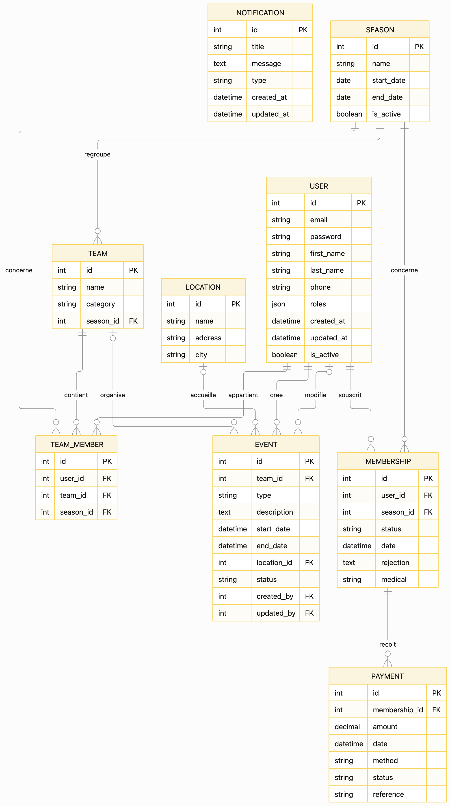

# ASBF

## Vision
ASBF est l'application qui va simplifier la gestion de l’Association Sportive  Futsal de Bezons (AS Besons Futsal). Elle centralise tous les outils en un seul lieu et permet à chaque acteur de l’association de retrouver les informations et outils qui le concerne.

## Product Goal
Gérer l'association AS Futsal Bezons devient difficile. cela implique la gestion d'environ 300 adhérents (des enfants dès 6 ans jusqu'aux seniors) avec une quinzaine d'équipes, les inscriptions, les autorisations parentales et les convocation aux différents événements du quotidien (entraînement, match..). L'association est gérée par des bénévoles et peine à suivre de façon raisonnable les données administratifs de tous ces adhérents. L'application **ASBF** a donc pour but de résoudre ces problèmes tout en respectant leurs contraintes budgetaires.

## Rôles de l'équipe

| Membre | Compte GitHub | Rôle |
|---|---|---|
| Max | [@DrCodx](https://github.com/DrCodx) | Product Owner & Developer |
| Romain | [@chouinou](https://github.com/chouinou) | Scrum Master & Developer |
| Paul | [@roussel12paul-sudo](https://github.com/roussel12paul-sudo) | Developer |
| Ivan | [@ivanraphei](https://github.com/ivanraphei) | Developer |


## Definition of Done

Un élément est terminé quand :
- [ ] Le scrum master et le lead dev de la story valident le code avant de merge
- [ ] Les règles de validation d’un formulaire sont dans l’entité et dans le formulaire
- [ ] L'écran doit correspondre au tant que possible à a maquette
- [ ] L’affichage est vérifié, d’abord sur téléphone puis sur ordinateur
- [ ] Le product owner vérifie que la feature résout bien la story avant de passer la carte en done

## Suivi et conception

- [Tableau Trello](https://trello.com/b/Svj4oNBP/as-bezons-futsal)
- [Repo github](https://github.com/chouinou/FutsalBezons)
- [Maquettes](docs/maquettes/)

## Modèle de données

### MLD


## Installation et lancement

### Prérequis

- PHP 8.4, avec l'extension `pdo_sqlite`
- Composer
- Git
- [Symfony CLI](https://symfony.com/download)

```bash
php -v
php -m            # la liste doit contenir pdo_sqlite
composer --version
symfony check:requirements
```

### Première installation

```bash
git clone https://github.com/chouinou/FutsalBezons
cd FutsalBezons
composer install
php bin/console doctrine:migrations:migrate
php bin/console doctrine:schema:validate
symfony server:start -d
symfony open:local
```

Le dépôt est public : tout le monde peut le cloner. Pour y pousser des branches, acceptez d'abord l'invitation de collaborateur sur GitHub.

Pour arrêter le serveur : `symfony server:stop`.

### Configuration locale

La configuration commune est dans `.env`. Vos réglages personnels et vos secrets vont dans `.env.local`, qui n'est pas versionné. Le dépôt étant public, tout ce qui est poussé est visible par tous. Les clés présentes dans les fichiers versionnés ne doivent jamais servir en production.

## Travailler avec Git

On ne développe pas directement sur `main`. Une tâche = une branche = une pull request.

### 1. Commencer une tâche

```bash
git switch main
git pull
composer install
php bin/console doctrine:migrations:migrate
git switch -c feature/nom-de-la-tache
```

### 2. Publier son travail

```bash
git status                 # vérifier les fichiers concernés
git add chemin/des/fichiers
git commit -m "Description courte du changement"
git push -u origin feature/nom-de-la-tache
```

Ouvrez une pull request vers `main`. Elle doit être approuvée par un autre membre et passer la CI avant la fusion.

### 3. Récupérer les nouveautés de `main` dans sa branche

Commitez d'abord votre travail, puis :

```bash
git fetch origin
git merge origin/main
composer install
php bin/console doctrine:migrations:migrate
```

## Base de données et migrations

Chaque membre a **sa propre base SQLite** : `var/data_dev.db`. Elle n'est pas versionnée.

| On partage avec Git | On garde en local |
|---|---|
| Les entités (`src/Entity/`) | Les fichiers `.db` |
| Les migrations (`migrations/`) | `.env.local` |
| Les fixtures (`src/DataFixtures/`), si installées | Les données saisies à la main |

### Modifier la base

1. Mettez votre branche et votre base à jour.
2. Créez ou modifiez l'entité : `php bin/console make:entity`
3. Générez la migration : `php bin/console make:migration`
4. **Relisez le fichier généré**, en particulier les suppressions et les reconstructions de tables. Avec des données existantes, vérifiez qu'elles sont conservées et qu'un nouveau champ obligatoire a une valeur pour les anciennes lignes.
5. Appliquez et vérifiez :

```bash
php bin/console doctrine:migrations:migrate
php bin/console doctrine:schema:validate
```

6. Commitez **l'entité et la migration ensemble**.

### Après un `git pull` ou un merge

```bash
composer install
php bin/console doctrine:migrations:migrate
```

N'utilisez pas `make:migration` pour récupérer le travail des autres : leurs migrations sont déjà dans le dépôt.

### Règles d'équipe

- Prévenez les autres avant de modifier une entité.
- Ne modifiez, renommez ou supprimez pas une migration fusionnée ou déjà utilisée par un autre membre. Créez-en une nouvelle.
- N'utilisez pas `doctrine:schema:update --force` : les changements passent par les migrations.
- Si deux branches modifient la base, intégrez la première fusionnée dans la seconde, puis testez sur une base neuve.

### Tester sur une base neuve

**Cette manipulation efface vos données locales de développement.** Arrêtez le serveur, renommez ou copiez `var/data_dev.db` si vous voulez la garder, ou supprimez ce fichier. Après renommage ou suppression :

```bash
php bin/console doctrine:migrations:migrate
php bin/console doctrine:schema:validate
```

Vérifiez au préalable que `.env.local` ne redirige pas `DATABASE_URL` vers une autre base.

### Données de test (si `orm-fixtures` est installé)

```bash
php bin/console doctrine:fixtures:load
```

**Cette commande vide la base avant de la remplir.** N'utilisez que des données fictives.
